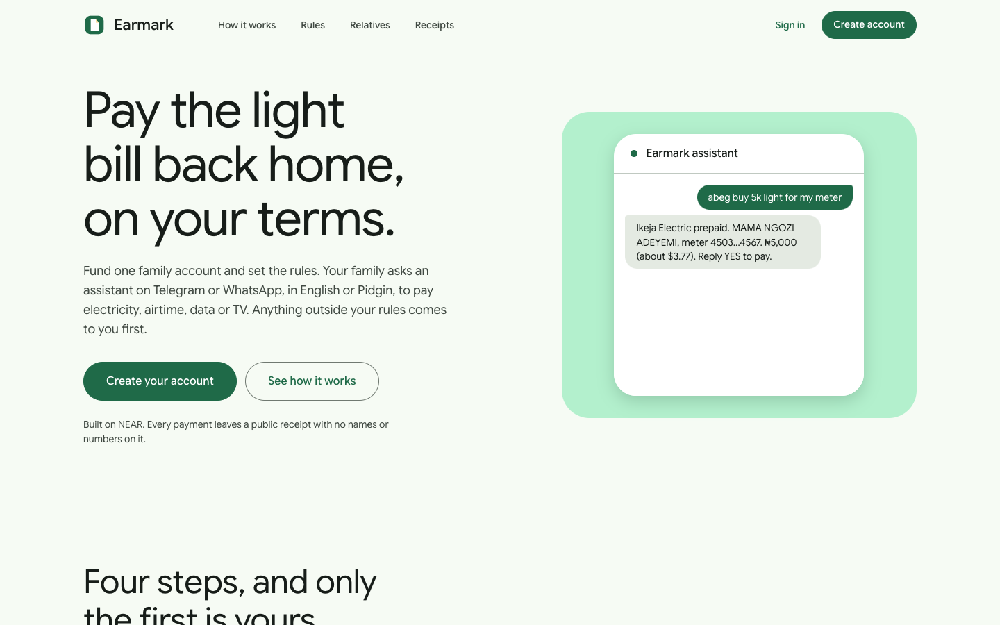
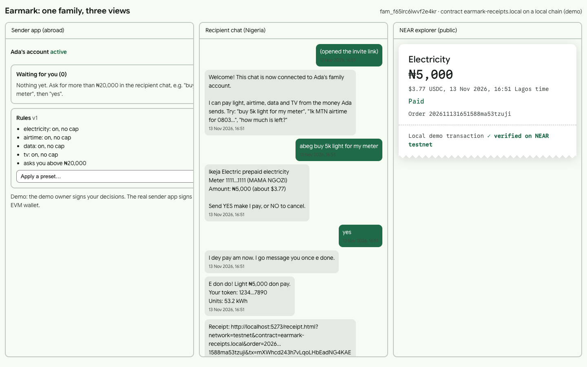
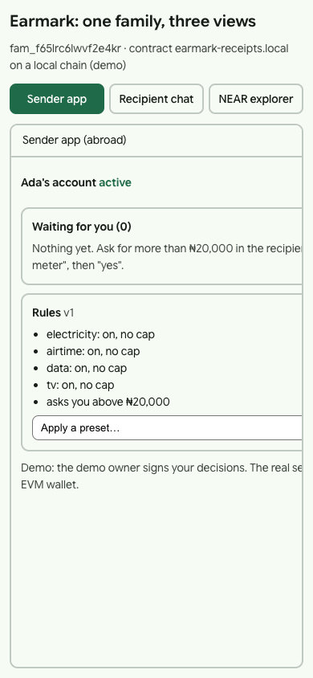

# Earmark

**Live app:** [earmark-web-o0gi.onrender.com](https://earmark-web-o0gi.onrender.com) · **Demo video (3½ min):** [watch on Google Drive](https://drive.google.com/file/d/1GjIurZJ0wXwsJAfjelTqCeFIcOg-BbAZ/view?usp=sharing)

**Judges:** start with [JUDGES.md](JUDGES.md): the [hosted app](https://earmark-web-o0gi.onrender.com), receipts read live from NEAR, and one command per claim with what you should see.

**What it is.** Send money home with rules. Someone abroad funds a family account from any chain and signs spending rules once. A family member then asks an AI assistant, in English or Pidgin, to pay household bills inside those rules: prepaid electricity, airtime, data and TV. Every payment gets a public receipt on NEAR with no personal data.

**The problem.** Nigerians abroad sent home $21.8B in 2025, and senders can't control how it gets spent. Cash sent home can't be limited to bills, and a bill paid by the sender needs the sender awake, online and on the phone. Earmark lets the sender set the rules once and lets the recipient do the asking.

**Status.** Built for the NEAR hackathon (tracks `realworld` and `agents`). The recipient side works end to end (chat → rules → biller → receipt → public page), and the sender web app is real: passkey sign-in, rules, approvals, freeze, a list of phones/meters/decoders the sender approved, and several relatives co-signing on one family. Settlement runs on NEAR testnet: a family vault contract holds each family's test USDC and pays our settlement account only inside the sender's hard limits, which it checks itself; the bot's key can only call `pay`. Not built yet: funding from real chains, refunds on-chain, and anything on mainnet. See [What is real and what is not](#what-is-real-and-what-is-not).

**Networks.** NEAR Intents has no testnet, so the Agent API pieces are spiked against mainnet with tiny dry-run amounts; everything else — the receipts contract, every order, every payment in this build — runs on testnet or a sandbox, and stays there through judging.

## Screenshots

The landing page, and the judge view after a real `make demo` run — "abeg buy 5k light for my meter", then "yes" — showing all three panes at once: the sender's rules, the recipient's chat in Pidgin, and the on-chain receipt.

| Landing page                                            | Judge view (desktop)                                                                                        |
| ------------------------------------------------------- | ----------------------------------------------------------------------------------------------------------- |
|  |  |

Judge view on a phone (tabs instead of three columns)




## Try it in 10 minutes, no keys, no money

Needs Node 24+ (`nvm use`), pnpm 12 (`corepack enable`) and `make`. Nothing else: no accounts, no `.env`.

```sh
make demo
```

| Do this                                                                                                                                   | See this                                                                                                                                                       |
| ----------------------------------------------------------------------------------------------------------------------------------------- | -------------------------------------------------------------------------------------------------------------------------------------------------------------- |
| `make demo`, then open the link it prints                                                                                                 | A page with three panes: sender app, recipient chat, and the chain                                                                                             |
| In the recipient chat, click **abeg buy 5k light for my meter**                                                                           | The bot looks up the meter, shows the owner's name (MAMA NGOZI), ₦5,000 (about $3.77) and asks for YES, in Pidgin because you wrote "abeg"                     |
| Click **yes**                                                                                                                             | "I dey pay am", then within seconds the electricity token, units and a receipt link                                                                            |
| Look at the chain pane                                                                                                                    | The receipt: amount, bill type, time, with "✓ verified" from the page's own check of the transaction. No name, phone or meter number                           |
| Type `buy 600k light for my meter`                                                                                                        | Refused in code: more than ₦500,000 in one payment                                                                                                             |
| Open `http://localhost:5173` (not 127.0.0.1) for the home page, then choose **Create your account** and **Create account with a passkey** | Your device asks for its fingerprint, face or PIN, and you land on "Set up your family"                                                                        |
| Enter a phone number, keep the demo meter, pick **Essentials**, **Create family**                                                         | Home: your budget in dollars next to naira, and a card with the recipient's invite and **Open the demo chat**                                                  |
| In the demo chat, ask for `buy 25k light for my meter`, then **yes**. Back in the app, open **Approvals**                                 | A card with the amount, the rule that tripped and **Approve** / **Decline**. Approving asks for your fingerprint again, and only that signature runs the order |
| **Rules** tab: switch TV on, change a cap, or pick another preset                                                                         | Saved at once; the next request follows the new rules                                                                                                          |
| **Family** tab: add a second phone number, then ask the recipient to buy airtime for a _different_ number you didn't add                  | Bought for the number you added; refused for the one you didn't — "That phone isn't on the list Ada set up, so I can't pay for it"                             |
| **Top up** tab                                                                                                                            | Says plainly that it isn't available in this build. No balance is invented                                                                                     |
| Type `buy 25k light for my meter`, then **yes** (in the judge page's sender pane)                                                         | The bot says it needs Ada's OK first. The sender pane shows a card with the amount, the rule that tripped and **Approve** / **Decline**; nothing is bought yet |
| Click **Approve**                                                                                                                         | The recipient hears "Ada said yes", then the token and receipt. **Decline** instead: "Ada declined this payment. Nothing was paid."                            |
| Click **Freeze everything**, then ask for any bill                                                                                        | Refused: "The account is frozen by the sender." A request waiting for approval is cancelled too                                                                |
| Click **yes** twice, fast                                                                                                                 | One bill; the second YES is told it is already on its way                                                                                                      |
| `make check`                                                                                                                              | Lint, secrets audit, build and all TypeScript tests, including the failure drills                                                                              |
| `pnpm test:contracts`                                                                                                                     | The receipts contract's unit tests and a near-workspaces sandbox run (needs Rust and cargo-near, see below)                                                    |

## What is real and what is not

| Part                                                                                                 | `make demo`                                                                                                                                                                                                       | With keys (`pnpm start:bot`)                                                                                                                                                                |
| ---------------------------------------------------------------------------------------------------- | ----------------------------------------------------------------------------------------------------------------------------------------------------------------------------------------------------------------- | ------------------------------------------------------------------------------------------------------------------------------------------------------------------------------------------- |
| Order rules, quotes, confirmation, executor, refunds logic, receipts, Pidgin, rate limit, monitoring | Real code                                                                                                                                                                                                         | Real code                                                                                                                                                                                   |
| VTpass bill purchase                                                                                 | Simulated, one bill per request, instant                                                                                                                                                                          | **Real VTpass sandbox** purchases and lookups                                                                                                                                               |
| Receipts contract                                                                                    | A local stand-in that answers the same RPC calls the page makes                                                                                                                                                   | **Real contract on NEAR testnet**, written by the service account                                                                                                                           |
| Understanding messages                                                                               | Plain rules; far less flexible than the model                                                                                                                                                                     | **NEAR AI Cloud** model (`deepseek/deepseek-v4.1-flash`)                                                                                                                                    |
| Naira rate                                                                                           | Fixed ₦1,346 per $                                                                                                                                                                                                | Live Coinbase and open.er-api, lower of the two, minus a 1.5% spread                                                                                                                        |
| Chat                                                                                                 | A web chat in the judge page                                                                                                                                                                                      | Telegram (live) and WhatsApp through the Twilio sandbox                                                                                                                                     |
| Family paying settlement                                                                             | Simulated                                                                                                                                                                                                         | **The family vault contract on NEAR testnet** pays settlement in test USDC and checks the sender's hard limits itself ([vault drill](evidence/vault-drill.md)). Refunds are still simulated |
| Sender approval card and decision                                                                    | Signed by the sender's **passkey** in the app (the judge page's demo owner signs for its own pane)                                                                                                                | Same; the real sender signs with their passkey                                                                                                                                              |
| Sender web app                                                                                       | **Real:** passkey sign-in, family setup, rule editing, approvals, freeze, activity, the list of phones/meters/decoders the sender allows, several relatives per family with co-signing. **Not available:** top-up | Same                                                                                                                                                                                        |

No mainnet transaction exists yet. The family vault is live on testnet at [`earmark-vault-3d4c5341.testnet`](https://testnet.nearblocks.io/address/earmark-vault-3d4c5341.testnet), holding test USDC from [`earmark-tusdc-b8f4bf88.testnet`](https://testnet.nearblocks.io/address/earmark-tusdc-b8f4bf88.testnet). The receipts contract is live on testnet at [`earmark-receipts-9e9730f1.testnet`](https://testnet.nearblocks.io/address/earmark-receipts-9e9730f1.testnet) with real receipts from VTpass sandbox purchases; the page verifies each one against the archival RPC. Mainnet deployment waits on the mainnet accounts in `.env.example`.

## NEAR pieces and what each does

| Piece                                | Status                                                           | What it does here                                                                                                                                                                                                                                                             |
| ------------------------------------ | ---------------------------------------------------------------- | ----------------------------------------------------------------------------------------------------------------------------------------------------------------------------------------------------------------------------------------------------------------------------- |
| Receipts contract (Rust, near-sdk 5) | Built, tested, on testnet                                        | One write-once receipt per order. Only the service account writes; anyone reads. No personal data: each string field is format-checked and the customer reference is a salted hash                                                                                            |
| Family vault (Rust, near-sdk 5)      | Built, tested, on testnet                                        | Holds each family's test USDC and pays settlement only inside the sender's hard limits: freeze, per-payment cap, monthly budget, and the list of numbers as salted hashes. One payment per order; a failed transfer is put back. The bot holds a key that can only call `pay` |
| Test USDC (NEP-141)                  | On testnet                                                       | A faucet token with 6 decimals, so the vault moves a real token on testnet. Worth nothing                                                                                                                                                                                     |
| NEP-297 events                       | In use                                                           | Every receipt emits `receipt_recorded`; the public page checks the event for the order in the transaction, so a link can't fake a receipt                                                                                                                                     |
| NEAR AI Cloud                        | In use                                                           | The model reads each chat message into fields. It never approves, prices or confirms anything                                                                                                                                                                                 |
| NEAR RPC (fastnear, archival)        | In use                                                           | The public page reads receipts and checks transactions straight from the chain, with no backend                                                                                                                                                                               |
| NEAR Intents Agent API               | Spiked (`pnpm spike:agent-api`), policy and refusal code written | Holds each family's account and policy: the only allowed destination is our settlement account. Not yet wired into the order flow                                                                                                                                             |
| 1Click deposits                      | Spiked, not wired                                                | A fresh deposit address per top-up, from any chain                                                                                                                                                                                                                            |

## Safety, in one list

- The model only extracts fields. Only a message that is plainly "yes" confirms, matched by a regex, and only while a summary is showing.
- Rules are checked in code after YES. A hard limit or a frozen account refuses; a category rule sends a card to the sender, who must approve or decline. Only a decision signed by a sender's passkey for that order counts (a family can ask for two or more relatives to sign), a stale price is re-quoted, and an unanswered request is cancelled after 24 hours.
- The recipient can only ask for a bill on a phone, meter or decoder the sender added in the app. Any other number is refused before a quote is even made, so a mistyped or unfamiliar number never becomes a payment.
- A 10-minute-old price is never paid. The float guard stops new orders when the VTpass balance is low.
- One order ID is never bought twice: state is saved before VTpass is called, and then the order is only requeried.
- The family vault on NEAR checks the hard limits again before any money moves. Its payment key can only call `pay`, so even a compromised payment path can't pay past a freeze, the per-payment cap, the monthly budget or the list of numbers ([vault drill](evidence/vault-drill.md), with a testnet transaction for each refusal).
- Failure drills (VTpass down, float empty, wrong meter, double YES, Agent API error, RPC down…) each end in a clear message plus a refund or a retry.

## Repository layout

| Path                  | What it is                                                                                                                                                       |
| --------------------- | ---------------------------------------------------------------------------------------------------------------------------------------------------------------- |
| `packages/config`     | Validated environment config per provider; errors never echo secret values                                                                                       |
| `packages/agent-api`  | NEAR Intents Agent API integration: family policy, owner signing, flows, refusal messages                                                                        |
| `packages/shared`     | Order, rule and receipt objects every part of the system agrees on, the rule checks and the order lifecycle                                                      |
| `contracts/receipts`  | NEAR contract holding on-chain receipts, with no personal data                                                                                                   |
| `contracts/vault`     | NEAR family vault (testnet): pays settlement only inside the sender's hard limits                                                                                |
| `contracts/test-usdc` | NEP-141 test dollar with an open faucet, for the vault on testnet                                                                                                |
| `services/orders`     | Placeholder service that only answers `/health`; the money flow will move here                                                                                   |
| `services/billers`    | Biller service: VTpass purchases, naira quotes, the float guard, and the order executor with refunds                                                             |
| `bot`                 | Telegram and WhatsApp assistant on NEAR AI Cloud                                                                                                                 |
| `apps/sender-web`     | Sender web app: passkey sign-in, rules, the phone/meter/decoder allowlist, family co-signing, approvals, receipts feed and top-ups (not available in this build) |
| `scripts`             | Operational scripts, including the account and key smoke check                                                                                                   |

## Developer commands

Requirements: Node 24+ (`nvm use`), pnpm 12, Rust stable with the `wasm32-unknown-unknown` target, and [cargo-near](https://github.com/near/cargo-near) 0.22 (`cargo install --locked cargo-near`). The contract must be built with cargo-near: a plain `cargo build` wasm deploys but cannot report its errors.

```sh
pnpm install
pnpm build   # TypeScript packages, the web app and the contract wasm (cargo near)
pnpm test    # vitest, contract unit tests and near-workspaces sandbox tests
pnpm lint
```

Copy `.env.example` to `.env` for local configuration. Keys are never committed.

Check that every account and key works (read-only; moves no money):

```sh
pnpm check:accounts
```

Agent API spike. Without `SPIKE_ALLOW_WRITES=true` it runs read-only preflight checks; with it, it creates a family account on mainnet and moves about $1 to the settlement account:

```sh
pnpm spike:agent-api
```

Receipts contract on NEAR testnet (free faucet accounts, keys kept in `.earmark/`). It deploys, writes one smoke receipt and prints its page link:

```sh
pnpm build:contracts
pnpm deploy:receipts:testnet
pnpm --filter @earmark/sender-web dev   # then open the printed receipt.html link
```

Family vault on NEAR testnet (faucet accounts, keys in `.earmark/vault-testnet.json`). It deploys the vault and its test USDC, gives the agent a key that can only call `pay`, runs one payment and one refusal, and prints the six `VAULT_TESTNET_*` values the bot reads. Then the vault drill runs a bill through the bot and four attempts a compromised payment path could make, each refused on chain:

```sh
pnpm build:contracts
pnpm deploy:vault:testnet
pnpm build:ts && pnpm drill:vault    # report in evidence/vault-drill.md
```

Biller drill. Runs 20 paid orders through the order executor: real VTpass sandbox purchases, live NGN/USD quotes, the float guard and on-chain receipts on the testnet contract. Two orders are forced to fail and must refund. The payment into settlement and the refund are simulated in this drill. Takes about 15 minutes: VTpass refuses a repeat bill for the same number within 30 seconds, so bills for the sandbox's single test phone number queue one behind another:

```sh
pnpm drill:billers   # needs pnpm deploy:receipts:testnet first; report in .earmark/
```

The assistant: Telegram and WhatsApp in front of a NEAR AI Cloud model. The model only reads each message into fields; the biller, the number checks, the price, the YES and every rule check are code. In demo mode each chat gets its own demo family wired to the VTpass sandbox test meter, smartcard and phone, and a YES really buys in the sandbox and writes a testnet receipt. With the six `VAULT_TESTNET_*` values set, the payment into settlement goes through the family vault on NEAR testnet; without them it is simulated:

```sh
pnpm build && pnpm start:bot   # prints an invite link for a demo family, and its judge view
pnpm eval:bot                  # 15 English and Pidgin phrasings through the real model
```

Recipient flow and public receipts. The recipient opens the invite link (`t.me/<bot>?start=<code>`, or `start <code>` on WhatsApp) and the chat is connected to the family. Each payment gets a public page with the amount, bill type, time and on-chain transaction, and no names, phone numbers, meter numbers or tokens. The page checks the transaction against the chain itself. The judge view shows one family in three panes: the sender's app, the recipient's chat (long numbers masked) and the chain:

```sh
pnpm --filter @earmark/sender-web dev   # serves receipt.html and judge.html on :5173
pnpm drill:recipient                    # one message → sandbox purchase → receipt on the page, timed
```

Hardening and failure drills. The drills run the bot, the demo wiring, the order executor and the float guard end to end against a simulated VTpass, payer and chain, with no keys. Each one must end in a clear message plus a refund or a retry, never a lost payment. They run in CI on every push to `main`. The audit looks for secrets in every file git would commit and, locally, for every `.env` secret value in the whole git history; it prints names, never values:

```sh
pnpm drill:failures   # VTpass down, float empty, wrong meter, double YES, Agent API error, RPC down…
pnpm audit:secrets
curl localhost:4003/status   # orders by status, stuck orders, float and recent alerts (localhost only)
```

Set `ALERTS_TELEGRAM_CHAT_ID` to have alerts (low float, stuck orders, missing receipts, failure rate, bot errors) sent to a Telegram chat as well as the console.

For WhatsApp, run a tunnel to `BOT_PORT`, set `BOT_PUBLIC_URL` to it, and set `<BOT_PUBLIC_URL>/webhooks/whatsapp` as the Twilio sandbox's incoming-message URL.

## Privacy

Names, phone numbers, meter numbers and tokens never go on-chain. Each receipt carries an HMAC-SHA256 of the customer reference, keyed by a per-family secret that stays in our database. The judge view masks long numbers in the chat.

## Tracks

`realworld` and `agents`. Earmark is a stablecoin remittance rail a family could use tomorrow (`realworld`: STABLECOINS, NEAR INTENTS), fronted by an agent the recipient talks to in plain English or Pidgin that never holds a key of its own — every spend is checked against sender-signed rules in code, and large or unlisted spends need a passkey-signed approval (`agents`: AGENT COMMERCE). We did not claim `social`: that track's hint is to build on top of Sputnik DAO and Trezu rather than roll your own multisig, and the family co-signing here is exactly a rolled-your-own multisig, built before that hint existed as a track fit. Naming it instead of claiming it felt more honest than stretching the fit.

## Baseline and disclosure

- **No code from before the hackathon.** Open-source libraries in use: zod, React, Vite, near-sdk-rs, near-workspaces, vitest, Biome, `@near-intents-agent-api/sdk` and near-api-js. The Agent API flows follow the patterns in the NEAR-Intents-Agent-API SDK README and examples repository.
- **Our role.** Earmark is the naira settlement partner: families pay USDC to our settlement account, and we pay the bill from our VTpass wallet in naira. The VTpass float is ours, topped up in naira.
- **Mocked in** `make demo`**:** VTpass, the chain, the model and the naira rate (table above). The simulated VTpass delivers every bill; the real one can refuse, delay or reverse, which the drills cover.
- **Not built yet:** funding from real chains and top-ups (they need the mainnet accounts), refunds on-chain, sign-in with a NEAR or EVM wallet, and an OutLayer attested purchase. The real-family pilot has not run, so there are no pilot numbers here.
- **Other projects:** none is named yet; if anyone on the team also works on another hackathon project, it will be listed here.

## License

[MIT](LICENSE).
